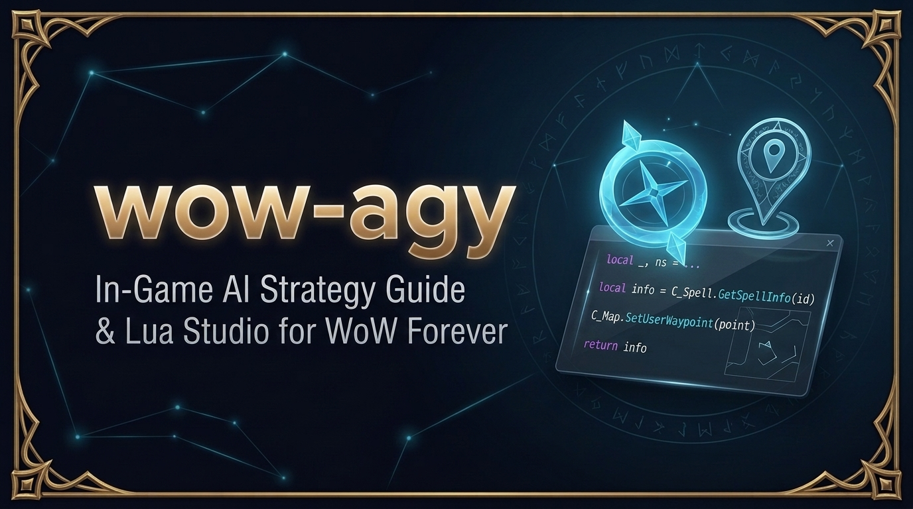

# wow-agy

English | [한국어](docs/README.ko.md) | [日本語](docs/README.ja.md) | [简体中文](docs/README.zh-CN.md)

`wow-agy` (`WoWAGY`) is an in-game World of Warcraft addon and local companion bridge that connects **World of Warcraft: Forever** (`Interface: 16001`) to Google Antigravity (`agy` CLI or the `google-antigravity` Python SDK).

You can use it inside the game to ask gameplay questions (quest routes, boss mechanics, item drops, class builds), run live Lua snippets without reloading, inspect runtime Lua errors from any addon, and edit files in `Interface/AddOns/`.

## How It Works

World of Warcraft runs addons in a sandboxed Lua 5.1 environment with no network or process access. `wow-agy` stays within documented Blizzard APIs and communicates with a local Python process in two ways:

1. **Clipboard bridge (no `/reload` needed)**: Copy a compact request packet from an in-game `EditBox` (`Ctrl+C` / `Cmd+C`). The local daemon runs Antigravity and puts the formatted answer, Lua snippet, macro, or map coordinates onto your clipboard so you can paste (`Ctrl+V` / `Cmd+V`) straight back into the addon window.
2. **`SavedVariables` sync**: Flush queued requests to `WTF/Account/.../SavedVariables/WoWAGY.lua` on `/reload`. The daemon edits addon files in `Interface/AddOns/` and writes replies to `AddOn/WoWAGY/Inbox.lua` for the next reload.

It does not read game memory, scan screen pixels, inject synthetic input, or automate combat actions.

## Features

- **Context-aware WoW Q&A**: Optionally attaches character info, zone coordinates, equipped items (slots 1 to 18), profession ranks, current target (name and NPC ID), and active quest objectives.
- **Item and spell tooltip inspection**: `Shift+Click` or drag items and spells into the prompt box to attach their stats and descriptions via `C_TooltipInfo.GetHyperlink`.
- **Map pins and chat summary**: Set native map waypoints (`UiMapPoint` + `C_SuperTrack`) from coordinates in answers, or share a short 3-line summary to Party, Raid, or Guild chat.
- **Live Lua editor**: Write and run Lua 5.1 code in-game (`loadstring`) with captured `print()` output and execution timing.
- **Lua error debugger**: Chains `seterrorhandler` to record stack traces from other addons so you can send them to Antigravity for diagnosis.
- **Safe macro helper**: Creates or updates macros outside combat, warns if `/run` or `/script` is present, and supports `/agy undo` to restore the previous macro state.
- **12 UI languages**: Defaults to English (`enUS`), auto-detects all official WoW client locales (`GetLocale()`), and includes manual switching for Japanese (`jaJP`) and other languages via `/agy lang <code>`.

## Requirements

- World of Warcraft: Forever (`Interface: 16001`)
- [`uv`](https://docs.astral.sh/uv/) (recommended, manages Python 3.15 and dependencies automatically) or Python 3.13+
- Either the Antigravity CLI (`agy`) or the `google-antigravity` Python package

Install `uv` if needed:

```bash
# macOS / Linux
curl -LsSf https://astral.sh/uv/install.sh | sh

# Windows (PowerShell)
powershell -ExecutionPolicy ByPass -c "irm https://astral.sh/uv/install.ps1 | iex"
```

## Installation

Clone the repository and link (or copy) the addon into your WoW Forever `Interface/AddOns` directory:

```bash
git clone https://github.com/JAICHANGPARK/wow-agy.git
cd wow-agy

# macOS / Linux (creates a symlink to AddOn/WoWAGY)
chmod +x ./scripts/install.sh
./scripts/install.sh "/Applications/World of Warcraft/_forever_"
```

On Windows (PowerShell):

```powershell
.\scripts\install.ps1 "C:\Program Files (x86)\World of Warcraft\_forever_"
```

## Authentication

Run the setup helper to configure authentication, or check your current setup:

```bash
uv run wow-agy-daemon --setup-auth
uv run wow-agy-daemon --check-auth
```

Supported authentication options:

1. **`agy` CLI login (no API key)**: Install `agy` (`curl -fsSL https://antigravity.google/cli/install.sh | bash` on macOS/Linux, or `irm https://antigravity.google/cli/install.ps1 | iex` on Windows PowerShell), then run `agy` once to sign in with Google in your browser.
2. **Google AI Studio API key**: Get a key from https://aistudio.google.com/app/api-keys and save it via `--setup-auth` (stored in a git-ignored `.env` file with `0600` permissions) or set `GEMINI_API_KEY`.
3. **Vertex AI / Gemini Enterprise**: Run `gcloud auth application-default login` and pass `--vertex --project <GCP_PROJECT_ID>`.
4. **Local models (no account or key)**: Run on-device LiteRT checkpoints (`--litert-model`) or connect to a local Ollama / LM Studio server (`--local-openai-url`).

## Running the Bridge

Start the companion process before or while playing:

```bash
# Default (uses SDK if configured, otherwise falls back to authenticated agy CLI)
uv run wow-agy-daemon --wow-dir "/Applications/World of Warcraft/_forever_"

# Local Ollama / LM Studio server
uv run wow-agy-daemon --backend sdk --local-openai-url http://localhost:11434/v1 --local-model gemma4:26b

# On-device LiteRT model
uv run --extra litert wow-agy-daemon --backend sdk --litert-model ~/.litert-lm/models/gemma4-26b/model.litertlm
```

If you want to expose live player state and captured Lua errors directly to `agy` CLI or Antigravity IDE as MCP tools:

```bash
agy mcp add wow-forever -- env WOW_FOREVER_DIR="/Applications/World of Warcraft/_forever_" uv --directory "$(pwd)" run wow-agy-mcp
```

## In-Game Usage

Open the window from the minimap `AGY` button (or Blizzard's Addon Compartment menu) or type `/agy`.

### Asking questions or running code without reloading

1. Type a prompt (or click a preset button, or `Shift+Click` / drag an item into the input box).
2. Press `Ctrl+Enter` (or click `Copy Request (No-Reload)`) and copy with `Ctrl+C` (`Cmd+C` on macOS).
3. After the desktop notification appears, click `Paste Reply / Code`, paste with `Ctrl+V` (`Cmd+V`), and click `Show Reply in Chat` or `Run Code`.

### Creating or editing addon files on disk

1. Enter your request and click `Send / Sync (/reload)` (or press `Alt+Enter`).
2. Wait for the desktop notification confirming the file edits finished, then run `/reload` (`Shift+Click` the minimap button) to load the changes.

## Slash Commands

| Command | Description |
| :--- | :--- |
| `/agy`, `/wow-agy` | Toggle the main window |
| `/wowask <question>`, `/wowq <question>` | Queue a WoW gameplay question and open the window |
| `/agy lua` | Open the Live Lua Studio tab |
| `/agy errors` | Open the Lua Error Debugger tab |
| `/agy run <code>` | Run a one-line Lua snippet |
| `/agy lang <code\|auto>` | Change UI and AI response language (`enUS`, `koKR`, `jaJP`, `zhCN`, `zhTW`, `deDE`, `frFR`, `esES`, `esMX`, `ptBR`, `ruRU`, `itIT`) |
| `/agy undo` | Revert the last macro created or updated by `wow-agy` |
| `/agy about` | Print version, author, and repository URL |
| `/agy sync` | Run `/reload` when out of combat |

Keybindings can also be assigned in `ESC -> Options -> Keybindings -> AddOns`.

## Policy Compliance

`wow-agy` follows Blizzard's UI Add-On Development Policy:

- Distributed free of charge under the MIT License with plain-text Lua and XML source files.
- Contains no advertisements, paywalls, or donation prompts.
- Respects `InCombatLockdown()` and `C_Secrets` restrictions; performs no gameplay or combat automation.

## Tests

```bash
uv run python -m unittest discover -s tests -v
```

## Author & License

- Author: JAICHANGPARK (Dreamwalker)
- Repository: https://github.com/JAICHANGPARK/wow-agy
- License: [MIT](LICENSE)
