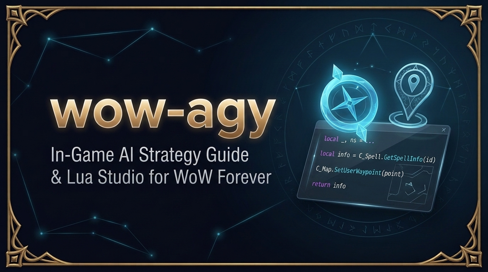

# wow-agy

[English](../README.md) | 한국어 | [日本語](README.ja.md) | [简体中文](README.zh-CN.md)

`wow-agy` (`WoWAGY`)는 **월드 오브 워크래프트: 포에버** (`Interface: 16001`) 클라이언트와 로컬 Google Antigravity (`agy` CLI 또는 `google-antigravity` Python SDK)를 연결하는 인게임 애드온 및 브릿지 도구입니다.

게임 창을 내리지 않고 퀘스트 동선, 던전/보스 공략, 아이템 드랍 및 장비 비교 질문을 하거나, 인게임에서 바로 Lua 코드를 실행하고 다른 애드온의 런타임 에러를 디버깅할 수 있습니다.

## 동작 구조

와우의 Lua 5.1 샌드박스는 외부 네트워크 통신과 프로세스 실행을 허용하지 않습니다. `wow-agy`는 블리자드 공식 API 범위 안에서 다음 두 가지 방식으로 로컬 브릿지와 데이터를 주고받습니다.

1. **클립보드 브릿지 (`/reload` 불필요)**: 인게임 입력창(`EditBox`)에서 요청 패킷을 복사(`Ctrl+C` / `Cmd+C`)하면 백그라운드 데몬이 Antigravity를 실행하고 결과를 클립보드에 넣어줍니다. 게임 안에서 붙여넣기(`Ctrl+V` / `Cmd+V`)만 하면 로딩 화면 없이 바로 답변을 읽거나 코드를 실행할 수 있습니다.
2. **`SavedVariables` 파일 동기화**: `/reload` 시 `WTF/Account/.../SavedVariables/WoWAGY.lua`로 요청을 내보내고, 데몬이 `Interface/AddOns/` 폴더의 실제 애드온 파일을 수정한 뒤 `AddOn/WoWAGY/Inbox.lua`에 결과를 기록합니다.

화면 픽셀 스캔, 프로세스 메모리 접근, 가상 키 입력, 전투 자동화 같은 우회 기법은 사용하지 않습니다.

## 주요 기능

- **플레이 상태 기반 와우 Q&A**: 캐릭터 정보, 현재 좌표, 착용 장비(1~18번 슬롯), 전문기술 숙련도, 현재 타겟(이름 및 NPC ID), 진행 중인 퀘스트 목표를 선택적으로 첨부해 질문할 수 있습니다.
- **아이템 및 주문 툴팁 분석**: 가방 아이템이나 주문을 `Shift+클릭`하거나 입력창으로 드래그하면 `C_TooltipInfo.GetHyperlink` API로 실제 능력치 텍스트를 추출해 함께 전달합니다.
- **지도 핀 설정 및 채팅 공유**: 답변에 좌표가 있으면 와우 기본 지도 핀(`UiMapPoint` + `C_SuperTrack`)을 바로 찍을 수 있고, 파티/공격대/길드 채팅으로 최대 3줄 요약을 공유할 수 있습니다.
- **Live Lua 에디터**: `/reload` 없이 `loadstring`으로 Lua 코드를 즉시 실행하고 `print()` 출력과 소요 시간을 확인합니다.
- **런타임 Lua 에러 디버거**: `seterrorhandler` 체인을 통해 다른 애드온에서 발생한 에러와 스택 트레이스를 모아 두고 원인 분석 및 수정을 요청할 수 있습니다.
- **매크로 생성 및 되돌리기**: 비전투 상태에서 매크로를 생성/갱신하며, `/agy undo`로 직전 매크로 상태를 복구할 수 있습니다.
- **다국어 지원**: 기본 언어는 영어(`enUS`)이며, 와우 클라이언트의 공식 로케일(`GetLocale()`) 자동 감지 및 한국어(`koKR`), 일본어(`jaJP`), 중국어(`zhCN`/`zhTW`) 등 12개 언어 실시간 전환(`/agy lang <코드>`)을 지원합니다.

## 요구 사항

- 월드 오브 워크래프트: 포에버 (`Interface: 16001`)
- [`uv`](https://docs.astral.sh/uv/) (권장, Python 3.15 및 의존성 자동 관리) 또는 Python 3.13 이상
- Antigravity CLI (`agy`) 또는 `google-antigravity` Python 패키지

`uv` 설치 명령어:

```bash
# macOS / Linux
curl -LsSf https://astral.sh/uv/install.sh | sh

# Windows (PowerShell)
powershell -ExecutionPolicy ByPass -c "irm https://astral.sh/uv/install.ps1 | iex"
```

## 설치 방법

저장소를 클론한 뒤 설치 스크립트로 와우 포에버 `Interface/AddOns` 폴더에 연결합니다.

```bash
git clone https://github.com/JAICHANGPARK/wow-agy.git
cd wow-agy

# macOS / Linux (AddOn/WoWAGY 심볼릭 링크 생성)
chmod +x ./scripts/install.sh
./scripts/install.sh "/Applications/World of Warcraft/_forever_"
```

Windows (PowerShell):

```powershell
.\scripts\install.ps1 "C:\Program Files (x86)\World of Warcraft\_forever_"
```

## 인증 설정

대화형 설정 도구로 인증을 구성하거나 현재 상태를 확인할 수 있습니다.

```bash
uv run wow-agy-daemon --setup-auth
uv run wow-agy-daemon --check-auth
```

지원하는 인증 방식:

1. **`agy` CLI 구글 로그인 (API 키 불필요)**: `agy` 설치(`curl -fsSL https://antigravity.google/cli/install.sh | bash` 또는 Windows PowerShell `irm https://antigravity.google/cli/install.ps1 | iex`) 후 터미널에서 `agy`를 한 번 실행해 브라우저 로그인을 완료합니다.
2. **Google AI Studio API 키**: https://aistudio.google.com/app/api-keys 에서 발급받은 키를 `--setup-auth`로 등록(`.env` 파일에 `0600` 권한으로 저장, Git 제외)하거나 `GEMINI_API_KEY` 환경변수로 지정합니다.
3. **Vertex AI / Gemini Enterprise**: `gcloud auth application-default login` 실행 후 `--vertex --project <GCP_PROJECT_ID>` 옵션을 사용합니다.
4. **로컬 모델 (인증 불필요)**: 온디바이스 LiteRT 모델(`--litert-model`) 또는 로컬 Ollama / LM Studio 서버(`--local-openai-url`)에 연결합니다.

## 브릿지 데몬 실행

게임을 실행하기 전이나 플레이 도중에 로컬 데몬을 켜 둡니다.

```bash
# 기본 실행
uv run wow-agy-daemon --wow-dir "/Applications/World of Warcraft/_forever_"

# 로컬 Ollama / LM Studio 서버 사용 시
uv run wow-agy-daemon --backend sdk --local-openai-url http://localhost:11434/v1 --local-model gemma4:26b

# 온디바이스 LiteRT 모델 사용 시
uv run --extra litert wow-agy-daemon --backend sdk --litert-model ~/.litert-lm/models/gemma4-26b/model.litertlm
```

`agy` CLI나 Antigravity IDE에 MCP 서버로 등록하려면 다음 명령을 실행합니다.

```bash
agy mcp add wow-forever -- env WOW_FOREVER_DIR="/Applications/World of Warcraft/_forever_" uv --directory "$(pwd)" run wow-agy-mcp
```

## 인게임 사용법

미니맵의 `AGY` 버튼(또는 미니맵 우측 상단 기본 애드온 모음함 메뉴)을 클릭하거나 채팅창에 `/agy`를 입력해 창을 엽니다.

- **리로드 없이 질문/실행 (클립보드 모드)**: 질문을 입력하고 `Ctrl+Enter`를 눌러 패킷을 복사(`Ctrl+C` / `Cmd+C`)합니다. 데스크톱 완료 알림이 오면 `클립보드 답변/코드 붙여넣기`에서 붙여넣어(`Ctrl+V` / `Cmd+V`) 대화창에 표시하거나 바로 실행합니다.
- **애드온 파일 생성 및 수정 (`SavedVariables` 동기화)**: 요청 입력 후 `전송 / 답변 동기화 (/reload)`(`Alt+Enter`)를 실행합니다. 파일 수정 완료 알림이 뜬 뒤 한 번 더 `/reload` 하면 변경 사항이 반영됩니다.

## 슬래시 명령어

| 명령어 | 설명 |
| :--- | :--- |
| `/agy`, `/wow-agy` | 메인 창 열기/닫기 |
| `/와우질문 <질문>`, `/wowask <질문>` | 와우 공략/퀘스트/아이템 질문 등록 및 창 열기 |
| `/agy lua` | Live Lua 에디터 탭 열기 |
| `/agy errors` | Lua 에러 디버거 탭 열기 |
| `/agy run <코드>` | 한 줄 Lua 코드 즉시 실행 |
| `/agy lang <코드\|auto>` | 표시 언어 및 AI 답변 언어 변경 (`koKR`, `enUS`, `jaJP`, `zhCN` 등) |
| `/agy undo` | 직전에 생성하거나 수정한 매크로 되돌리기 |
| `/agy about` | 버전, 제작자, GitHub 저장소 주소 출력 |
| `/agy sync` | 비전투 상태에서 `/reload` 실행 |

단축키는 `ESC -> 설정 -> 단축키 -> 애드온` 메뉴에서도 지정할 수 있습니다.

## 블리자드 애드온 정책 준수

- MIT 라이선스 기반 무료 오픈소스로 배포되며 모든 Lua/XML 코드는 평문으로 공개되어 있습니다.
- 인게임 광고, 유료 결제 유도, 후원 링크를 포함하지 않습니다.
- `InCombatLockdown()` 및 `C_Secrets` 보안 제한을 준수하며 전투 및 플레이 자동화를 수행하지 않습니다.

## 테스트

```bash
uv run python -m unittest discover -s tests -v
```

## 제작자 및 라이선스

- 제작자: JAICHANGPARK (Dreamwalker)
- 저장소: https://github.com/JAICHANGPARK/wow-agy
- 라이선스: [MIT](../LICENSE)
