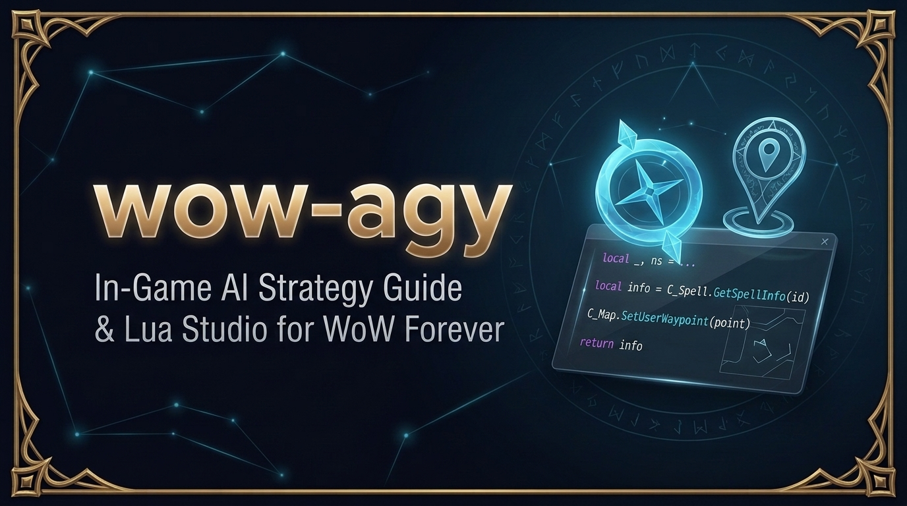

# wow-agy

[English](../README.md) | [한국어](README.ko.md) | [日本語](README.ja.md) | 简体中文

`wow-agy` (`WoWAGY`) 是面向 **《魔兽世界：永恒》(World of Warcraft: Forever, `Interface: 16001`)** 的游戏内插件与本地桥接工具，用于在游戏内连接 Google Antigravity (`agy` CLI 或 `google-antigravity` Python SDK)。

无需切出游戏即可查询任务路线、副本机制、掉落与配装建议，也可以在游戏内直接运行 Lua 代码片段、捕获报错堆栈并修改 `Interface/AddOns/` 下的插件文件。

## 工作方式

魔兽客户端的 Lua 5.1 沙盒禁止网络访问与外部进程调用。`wow-agy` 仅使用暴雪公开的合法 API，通过以下两种方式与本地 Python 进程通信：

1. **剪贴板桥接 (无需 `/reload`)**：从游戏内输入框 (`EditBox`) 复制请求文本 (`Ctrl+C` / `Cmd+C`)，本地守护进程调用 Antigravity 后将结果写回剪贴板，在游戏窗口粘贴 (`Ctrl+V` / `Cmd+V`) 即可查看回答或执行代码。
2. **`SavedVariables` 同步**：执行 `/reload` 时将队列写入 `WTF/Account/.../SavedVariables/WoWAGY.lua`，守护进程完成文件修改后把回复写入 `AddOn/WoWAGY/Inbox.lua`，下次重载界面时读取。

本项目不读取游戏内存、不扫描屏幕像素、不模拟按键输入，也不包含任何战斗自动化逻辑。

## 功能概览

- **结合角色状态的魔兽问答**：可选择附带角色等级与职业、当前坐标、全身已装备物品 (1 至 18 栏位)、专业技能点数、当前目标 (名称与 NPC ID) 以及任务进度。
- **物品与技能词条解析**：将物品或技能 `Shift+点击` 或拖拽到输入框，即可通过 `C_TooltipInfo.GetHyperlink` 提取真实属性文本供对比分析。
- **地图标点与聊天分享**：可将回答中的坐标设为原生地图标记 (`UiMapPoint` + `C_SuperTrack`)，或将最多 3 行摘要发送到小队/团队/公会频道。
- **实时 Lua 编辑器**：通过 `loadstring` 免重载运行代码并查看 `print()` 输出与耗时。
- **Lua 报错调试**：链式挂载 `seterrorhandler` 记录各插件报错堆栈，便于直接提交诊断修复。
- **多语言界面**：默认英语 (`enUS`)，自动识别客户端语言 (`zhCN`、`zhTW` 等 12 种语言)，也可通过 `/agy lang zhCN` 实时切换。

## 环境要求

- World of Warcraft: Forever (`Interface: 16001`)
- [`uv`](https://docs.astral.sh/uv/) (推荐，自动管理 Python 3.15 与依赖包) 或 Python 3.13+
- Antigravity CLI (`agy`) 或 `google-antigravity` Python 包

## 安装步骤

```bash
git clone https://github.com/JAICHANGPARK/wow-agy.git
cd wow-agy

# macOS / Linux
chmod +x ./scripts/install.sh
./scripts/install.sh "/Applications/World of Warcraft/_forever_"
```

Windows (PowerShell)：

```powershell
.\scripts\install.ps1 "C:\Program Files (x86)\World of Warcraft\_forever_"
```

## 认证配置与启动

首次使用可运行配置向导或检查当前认证状态：

```bash
uv run wow-agy-daemon --setup-auth
uv run wow-agy-daemon --check-auth
```

- 使用 `agy` CLI：安装 `agy` (`curl -fsSL https://antigravity.google/cli/install.sh | bash`，Windows PS 为 `irm https://antigravity.google/cli/install.ps1 | iex`) 后运行一次 `agy` 完成浏览器登录。
- 使用 Google AI Studio API Key：在 https://aistudio.google.com/app/api-keys 创建密钥，通过 `--setup-auth` 保存至 `.env` (`0600` 权限，已忽略提交)。
- 使用本地模型：搭配 LiteRT (`--litert-model`) 或本地 Ollama / LM Studio (`--local-openai-url`) 时无需账号或密钥。

启动本地守护进程：

```bash
uv run wow-agy-daemon --wow-dir "/Applications/World of Warcraft/_forever_"
```

## 常用斜杠命令

| 命令 | 说明 |
| :--- | :--- |
| `/agy`, `/wow-agy` | 打开或关闭主窗口 |
| `/wowask <问题>`, `/wowq <问题>` | 提交魔兽攻略、任务或装备问题 |
| `/agy lang <代码\|auto>` | 切换界面与回答语言 (`zhCN`、`zhTW`、`enUS`、`koKR`、`jaJP` 等) |
| `/agy lua` / `/agy errors` | 打开实时 Lua 编辑器 / 报错调试页 |
| `/agy undo` | 撤销上一次创建或修改的宏 |
| `/agy about` | 查看版本、作者与仓库地址 |
| `/agy sync` | 非战斗状态下执行 `/reload` |

## 作者与许可

- 作者: JAICHANGPARK (Dreamwalker)
- 仓库: https://github.com/JAICHANGPARK/wow-agy
- 许可证: [MIT](../LICENSE)
